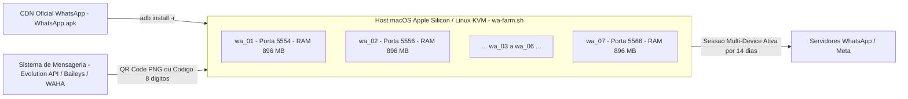
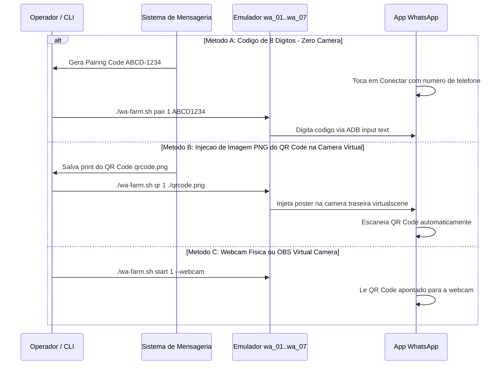

# 📱 wa-farm

[](LICENSE)
[](https://rogerin.github.io/wa-farm/)
[%20%7C%20Linux%20KVM-0E002A)](https://github.com/rogerin/wa-farm)
[-10B981)](https://github.com/rogerin/wa-farm)
[](CONTRIBUTING.md)

> 🌐 **Página Oficial & Calculadora Interativa de RAM:** **[https://rogerin.github.io/wa-farm/](https://rogerin.github.io/wa-farm/)**

**Orquestrador CLI ultra-leve para criar, emular e manter múltiplas contas de WhatsApp em emuladores Android isolados (`wa_01` a `wa_07+`) consumindo até 78% menos memória RAM.**

Projetado para desenvolvedores, equipes de operação e integradores de sistemas de mensageria (**Evolution API**, **WAHA**, **Baileys**, **WhatsMeow**, **Z-API**, **Chatwoot**, **Whaticket**) que precisam ativar chips/números novos sem depender de dezenas de aparelhos físicos na tomada — e sem travar a máquina com emuladores pesados do Android Studio.

---

## 🎯 O Problema vs. A Solução

Um emulador Android padrão criado no Android Studio (com Google Play Store, tela Full HD `1080x2400`, áudio e snapshots) consome entre **3,5 GB e 4,2 GB de RAM por instância**. Subir **7 contas de WhatsApp** exigiria **~28 GB de RAM**, inviabilizando notebooks de 16 GB/18 GB ou servidores VPS enxutos.

O **`wa-farm`** aplica **7 otimizações de baixo nível** no Android SDK/QEMU + ADB, reduzindo cada celular virtual para **~750 MB a 896 MB de RAM**:

| Camada | Emulador Padrão (Android Studio) | `wa-farm` (Perfil Ultra-Low-RAM) | Economia Real |
| :--- | :--- | :--- | :--- |
| **1. Imagem de Sistema** | `google_apis_playstore` (com Play Services) | **AOSP Puro (`android-31;default;arm64-v8a` / `x86_64`)** | **-600 MB RAM** (elimina `com.google.android.gms`) |
| **2. Instalação do WhatsApp** | Login manual na Google Play Store | **Download direto do APK Oficial da Meta via CDN** | Zero conta Google necessária |
| **3. Framebuffer / Display** | `1080x2400` (`420 dpi`) | **`360x640` (`160 dpi` mdpi)** | **-90% de memória gráfica (VRAM)** |
| **4. Teto de Hardware (`config.ini`)** | `2048 MB+` RAM / `256 MB+` Heap / `4 Cores` | **`896 MB` RAM / `96 MB` Heap / `1 Core` / `2 GB` Disco** | **-1.15 GB RAM** por VM |
| **5. Boot, Áudio e Snapshots** | Snapshots em RAM/Disco e subsistema de áudio | **`-no-snapshot -no-boot-anim -no-audio`** | Elimina picos de I/O e threads extras |
| **6. Debloat Android pós-boot** | Apps nativos rodando em segundo plano | **Desativa animações + congela 10 apps nativos via ADB** | **-150 MB RAM** dentro do guest Android |
| **7. Modo Headless + Heartbeat** | 7 janelas abertas 24/7 | **`-no-window -gpu off` + Renovação de 14 dias sob demanda** | **< 900 MB RAM total** na operação contínua |

---

## 🏗️ Arquitetura do Sistema



### Ciclo de Vida Inteligente de Memória (Como operar 7 contas gastando < 1 GB de RAM)

No protocolo **WhatsApp Multi-Device (Aparelhos Conectados)**, após escanear o QR Code ou digitar o código de pareamento de 8 dígitos, **o seu sistema de mensageria mantém a conexão ativa de forma independente por até 14 dias com o celular desligado**.

Por isso, o `wa-farm` suporta **dois modos de operação**:

1. **Modo On-Demand + Heartbeat Semanal (Recomendado — ~850 MB de RAM total):**
   - Você sobe **1 emulador por vez** (`./wa-farm.sh bootstrap 1`) para ativar o chip e escanear o QR Code, e desliga em seguida (`./wa-farm.sh stop 1`).
   - Uma vez por semana, o comando `./wa-farm.sh heartbeat` (ou via `cron`/`launchd`) liga cada uma das 7 contas em fila indiana no modo invisível (`--headless`), mantém o WhatsApp aberto por 60 segundos para renovar o token de 14 dias com a Meta e desliga antes de abrir a próxima.
2. **Modo Simultâneo (`./wa-farm.sh start all --headless` — ~6,2 GB de RAM total):**
   - Sobe todas as 7 instâncias simultaneamente em background sem interface gráfica Qt/QEMU (`-no-window -gpu off`).

---

## 📋 Pré-requisitos

### macOS (Apple Silicon M1/M2/M3/M4 ou Intel)
Instale o JDK 17+ e as ferramentas de linha de comando do Android via [Homebrew](https://brew.sh):

```bash
brew install --cask temurin android-commandlinetools android-platform-tools
```

### Linux (Ubuntu / Debian com KVM habilitado)
```bash
sudo apt update
sudo apt install -y openjdk-17-jdk curl unzip qemu-kvm libvirt-daemon-system adb
# Adicione seu usuário ao grupo kvm:
sudo usermod -aG kvm "$USER"
```

---

## 🚀 Começando em 3 Minutos (Quick Start)

### 🤖 Opção A — Instalação Automática via Agente de IA (Prompt com Engenharia de Contexto + Skill)

Se você usa **Claude Code**, **Gemini CLI / Antigravity**, **OpenAI Codex CLI** ou **Cursor**, basta copiar e colar o prompt estruturado abaixo (também disponível em [`PROMPT_INSTALACAO_E_SKILL_WA-ANDROID-FARM.md`](PROMPT_INSTALACAO_E_SKILL_WA-ANDROID-FARM.md)). O seu agente instalará a ferramenta e registrará automaticamente a **Skill Especialista (`wa-farm`)** para operar seus emuladores por comando de voz ou texto:

```xml
<context_engineering_prompt version="1.0.0" project="wa-farm">
  <role>
    Você é um Engenheiro DevOps Sênior especialista em Automação Android (SDK/ADB/QEMU) e Engenharia de Agentes de IA.
    Sua missão é instalar, configurar e validar a ferramenta open-source `wa-farm` (https://github.com/rogerin/wa-farm) na máquina local e instalar a Skill especialista `wa-farm` para operar emuladores Android Ultra-Low-RAM (~850 MB por instância) para múltiplas contas de WhatsApp.
  </role>
  <strict_constraints>
    1. NUNCA instale imagens pesadas com Google Play Store (`google_apis_playstore`). Use exclusivamente o fluxo oficial do `./wa-farm.sh` (`default;arm64-v8a` ou `default;x86_64`).
    2. Execute cada etapa no terminal, valide a saída e instale a skill nos diretórios globais do agente (`~/.claude/skills/`, `~/.gemini/config/skills/`, `~/.codex/skills/`, `~/.agents/skills/`).
  </strict_constraints>
  <execution_pipeline>
    1. Verifique `git`, `curl`, `adb`, `sdkmanager` e `avdmanager` (no macOS, se faltar, instale via `brew install --cask temurin android-commandlinetools android-platform-tools`).
    2. Clone o repositório em `~/wa-farm`:
       `git clone https://github.com/rogerin/wa-farm.git ~/wa-farm && cd ~/wa-farm && chmod +x wa-farm.sh install-skill.sh`
    3. Instale a Skill Especialista e o atalho global:
       `./install-skill.sh`
    4. Valide executando `./wa-farm.sh --version` e `./wa-farm.sh status`, exiba a tabela e pergunte se desejo iniciar a Conta #1 agora com `./wa-farm.sh bootstrap 1`.
  </execution_pipeline>
</context_engineering_prompt>
```

---

### 💻 Opção B — Instalação Manual no Terminal

### 1. Clone o repositório e instale a Skill
```bash
git clone https://github.com/rogerin/wa-farm.git
cd wa-farm
chmod +x wa-farm.sh install-skill.sh
./install-skill.sh
```

### 2. Comando Único ("Bootstrap") — Cria, abre, otimiza e instala o WhatsApp
Para preparar o ambiente (baixar o emulador, a imagem AOSP pura e o APK oficial da Meta), criar o celular virtual da **Conta #1 (`wa_01`)**, iniciar o emulador, aplicar o debloat de RAM e abrir o WhatsApp na tela:

```bash
./wa-farm.sh bootstrap 1
```
*(Repita trocando `1` por `2`, `3`, `4`, `5`, `6` ou `7` para cada novo número).*

### 3. Ou execute passo a passo
```bash
# Passo 1: Instala Android Emulator, imagem AOSP Android 12 e baixa o WhatsApp.apk oficial
./wa-farm.sh setup

# Passo 2: Cria todos os 7 AVDs ultra-leves (wa_01 a wa_07)
./wa-farm.sh create all

# Passo 3: Abre o emulador da Conta #1 (porta 5554)
./wa-farm.sh start 1

# Passo 4: Aplica debloat no Android, instala o WhatsApp.apk e abre o app
./wa-farm.sh install-wa 1
```

---

## 📷 Como Escanear o QR Code (ou Parear) dentro do Emulador

Depois de ativar o seu número novo no WhatsApp (via SMS ou ligação), toque em **Mais opções (`⋮`) > Aparelhos conectados > Conectar um aparelho**. Você tem **3 formas** de conectar ao seu sistema de mensageria:



### Método A — Código de Pareamento de 8 Dígitos (Mais Rápido, Zero Câmera)
1. Na tela de escanear QR Code do WhatsApp no emulador, toque em **"Conectar com número de telefone"** na barra inferior.
2. No seu sistema de mensageria (Evolution API, WAHA, Baileys, etc.), solicite o **Pairing Code** de 8 caracteres.
3. Envie o código diretamente pelo terminal:
   ```bash
   ./wa-farm.sh pair 1 ABCD1234
   ```

### Método B — Injeção Direta do PNG do QR Code na Câmera Virtual (`virtualscene`)
1. Tire um print apenas do QR Code exibido pelo seu sistema de mensageria (ex.: `~/Desktop/qrcode.png`).
2. Injete a imagem diretamente na cena virtual da câmera traseira do emulador:
   ```bash
   ./wa-farm.sh qr 1 ~/Desktop/qrcode.png
   ```
3. Ao abrir a câmera do WhatsApp no emulador, o QR Code estará estampado na parede/mesa virtual (`Toren1BD.posters`).
   - *Dica de navegação na cena virtual:* Segure `Option` (`Alt`) + mova o mouse para olhar ao redor, ou segure `Option` + teclas `W/A/S/D` para aproximar/afastar do QR Code. Se o emulador já estava aberto, você também pode atualizar a imagem em tempo real clicando em **`...` (Extended Controls) > Camera > Wall / Table > Load Image**.

### Método C — Usando a Webcam do Computador (ou OBS Virtual Camera)
Se preferir apontar um QR Code ou usar uma câmera virtual do OBS Studio:
```bash
./wa-farm.sh start 1 --webcam
```

---

## 🛠️ Referência Completa de Comandos (CLI, NPM e Make)

| Comando (`./wa-farm.sh`) | Atalho `npm` | Atalho `make` | Descrição |
| :--- | :--- | :--- | :--- |
| `./wa-farm.sh setup` | `npm run wa:setup` | `make setup` | Instala `emulator`, imagem AOSP (`android-31`) e baixa o `WhatsApp.apk` oficial da Meta |
| `./wa-farm.sh create all` | `npm run wa:create` | `make create` | Cria os 7 AVDs (`wa_01` a `wa_07`) com `config.ini` otimizado (`896 MB RAM`, `360x640`) |
| `./wa-farm.sh create <1..7>` | `npm run wa -- create 1` | — | Cria apenas o AVD da conta informada |
| `./wa-farm.sh bootstrap <1..7>` | `npm run wa -- bootstrap 1` | — | **Tudo em 1:** Cria AVD, sobe emulador, aplica debloat e instala/abre o WhatsApp |
| `./wa-farm.sh start <1..7>` | `npm run wa -- start 1` | — | Inicia o emulador da conta escolhida com janela gráfica compacta (`360x640`) |
| `./wa-farm.sh start <1..7> --headless` | `npm run wa -- start 1 --headless` | — | Inicia o emulador em background **sem janela (`-no-window -gpu off`)** |
| `./wa-farm.sh start all --headless` | `npm run wa -- start all --headless` | — | Inicia todas as 7 contas simultaneamente em modo headless |
| `./wa-farm.sh install-wa <1..7\|all>` | `npm run wa -- install-wa 1` | — | Aplica debloat via ADB, instala o `WhatsApp.apk`, libera câmera e abre o app |
| `./wa-farm.sh qr <1..7> ` | `npm run wa -- qr 1 qr.png` | — | Injeta a imagem PNG do QR Code na câmera virtual do emulador |
| `./wa-farm.sh pair <1..7> <CODIGO>` | `npm run wa -- pair 1 ABCD1234` | — | Digita o código de pareamento de 8 dígitos direto no emulador via ADB |
| `./wa-farm.sh status` | `npm run wa:status` | `make status` | Exibe tabela com as 7 contas, porta ADB, PID e **consumo real de RAM (MB)** |
| `./wa-farm.sh stop <1..7\|all>` | `npm run wa:stop-all` | `make stop` | Desliga graciosamente uma instância específica ou todas |
| `./wa-farm.sh heartbeat` | `npm run wa:heartbeat` | `make heartbeat` | Liga cada conta por 60s em modo headless (1 por vez) para renovar a sessão de 14 dias |

### Exemplo de Saída do `./wa-farm.sh status`
```text
CONTA    | AVD        | SERIAL ADB      | CRIADO?    | STATUS   | RAM (MB)    
---------+------------+-----------------+------------+----------+-------------
Conta #1 | wa_01      | emulator-5554   | SIM        | RODANDO  | 842 MB      
Conta #2 | wa_02      | emulator-5556   | SIM        | PARADO   | 0 MB        
Conta #3 | wa_03      | emulator-5558   | SIM        | PARADO   | 0 MB        
Conta #4 | wa_04      | emulator-5560   | SIM        | PARADO   | 0 MB        
Conta #5 | wa_05      | emulator-5562   | SIM        | PARADO   | 0 MB        
Conta #6 | wa_06      | emulator-5564   | SIM        | PARADO   | 0 MB        
Conta #7 | wa_07      | emulator-5566   | SIM        | PARADO   | 0 MB        
---------+------------+-----------------+------------+----------+-------------
Total em execução: 1/7 emuladores | Consumo total de RAM: 842 MB
```

---

## ⚙️ Variáveis de Ambiente (`.env`)

Você pode personalizar a quantidade de contas (de 7 para 15, 20, etc.) ou ajustar os limites de memória copiando o arquivo `.env.example`:

```bash
cp .env.example .env
```

| Variável | Padrão | Descrição |
| :--- | :---: | :--- |
| `WA_MAX_ACCOUNTS` | `7` | Quantidade total de emuladores gerenciados (`wa_01` até `wa_0N`) |
| `WA_RAM_MB` | `896` | Limite de memória RAM por emulador em MB (`768` a `1024` recomendado) |
| `WA_HEAP_MB` | `96` | Tamanho máximo do VM Heap do Android (`96` MB) |
| `WA_CPU_CORES` | `1` | Número de núcleos de CPU alocados por instância |
| `WA_LCD_WIDTH` | `360` | Largura da tela em pixels |
| `WA_LCD_HEIGHT` | `640` | Altura da tela em pixels |
| `WA_LCD_DENSITY` | `160` | Densidade de pixels (`160` dpi = `mdpi`) |
| `WA_ANDROID_API` | `31` | Nível da API do Android AOSP (`31` = Android 12) |
| `WA_DATA_SIZE` | `2048M` | Tamanho da partição de dados de cada aparelho (`userdata-qemu.img`) |
| `ANDROID_SDK_ROOT` | Auto-detectado | Caminho do SDK Android (`/opt/homebrew/share/android-commandlinetools` ou `~/Library/Android/sdk`) |

---

## ⏰ Automação de Produção (Renovação Semanal de Sessão com Cron)

Para garantir que nenhuma das 7 contas desconecte do seu sistema de mensageria após 14 dias de aparelho desligado, agende o `heartbeat` para rodar automaticamente **toda segunda-feira às 04:00 da manhã**:

```bash
crontab -e
```
Adicione a linha abaixo:
```cron
0 4 * * 1 /caminho/absoluto/para/wa-farm/wa-farm.sh heartbeat >> /tmp/wa-farm-heartbeat.log 2>&1
```

---

## 🛡️ Boas Práticas Anti-Banimento (Aquecimento / Warm-up)

1. **1 Número Novo = 1 AVD Exclusivo:** Nunca reutilize o mesmo AVD limpando dados para vários números. Cada `wa_01` a `wa_07` possui seu próprio `android_id` e partição isolada.
2. **Preenchimento de Perfil:** Assim que logar no número novo no emulador, adicione foto de perfil e nome antes de conectar o QR Code.
3. **Janela de Aquecimento (15–30 min):** Envie 2 ou 3 mensagens manuais entre os seus próprios números e aguarde pelo menos **15 a 30 minutos** após ativar o chip antes de escanear o QR Code da API de mensageria.

---

## 🔧 Troubleshooting (Solução de Problemas)

### 1. `sdkmanager` ou `avdmanager` não encontrado
Certifique-se de ter instalado o `android-commandlinetools` e o Java 17+:
```bash
brew install --cask temurin android-commandlinetools android-platform-tools
```

### 2. O QR Code aparece desfocado ou distante na câmera virtual (`virtualscene`)
- Segure a tecla `Option` (no Mac) ou `Alt` (no Linux) e use as teclas `W`, `A`, `S`, `D` para caminhar até o quadro do QR Code na parede virtual.
- Alternativamente, use o **Método A (`./wa-farm.sh pair 1 CODIGO8D`)**, que conecta via código de 8 dígitos sem depender da câmera.

### 3. Emulador demora no primeiro boot (`wait_for_boot`)
O **primeiro boot** de cada AVD (`wa_01`..`wa_07`) leva cerca de 35 a 60 segundos porque o Android inicializa a partição `userdata` e compila caches básicos (`dexopt`). Os boots seguintes levam menos de 20 segundos.

---

## 🌍 English Summary

**`wa-farm`** is an ultra-low-memory Android Emulator orchestrator built in pure Bash to create, boot, debloat, and manage multiple isolated WhatsApp accounts (`wa_01` to `wa_07+`) using **~850 MB RAM per instance** (a **78% reduction** compared to standard 4 GB Android Studio emulators).

- **Pure AOSP ARM64/x86_64 (`android-31`):** No Google Play Services bloat.
- **Direct Official APK:** Automatically downloads `WhatsApp.apk` from Meta's official CDN and installs via `adb`.
- **Headless & 14-Day Multi-Device Heartbeat:** Pair your messaging gateway (Evolution API, WAHA, Baileys) via Virtual Camera QR injection (`./wa-farm.sh qr 1 qrcode.png`) or 8-digit pairing code (`./wa-farm.sh pair 1 ABCD1234`), shut down the emulator, and run `./wa-farm.sh heartbeat` once a week to keep all sessions alive using under 900 MB of RAM.

---

## 🤝 Contribuindo

Contribuições, issues e Pull Requests são muito bem-vindos! Consulte o guia em [CONTRIBUTING.md](CONTRIBUTING.md).

## 📄 Licença

Distribuído sob a licença **MIT**. Veja [LICENSE](LICENSE) para mais informações.

---

Desenvolvido com foco em eficiência operacional por **[Rogério Alencar Filho (@rogerin)](https://github.com/rogerin)** & **[KeyCore Tech Hub](https://keycore.com.br)** — *Tecnologia que devolve tempo.*
